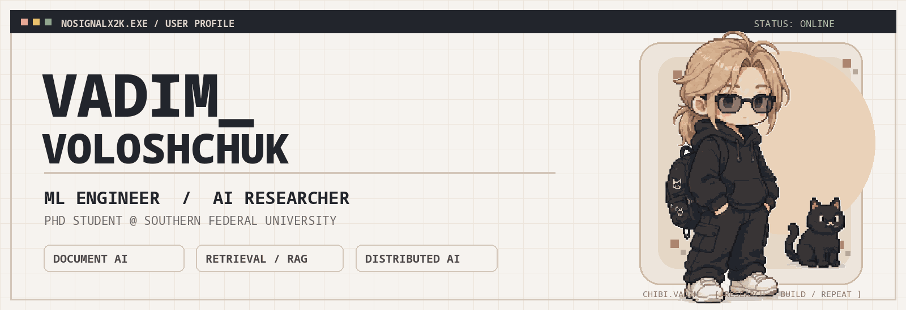
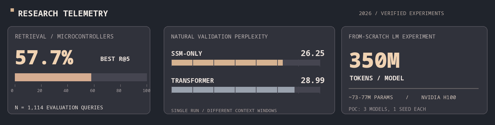
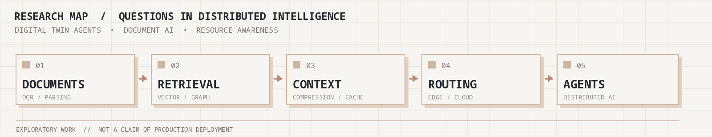
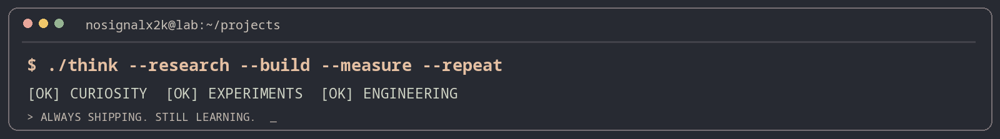

**Инженер структурированного интеллекта. Исследователь скрытых связей.**

[🇬🇧 English version](./README.md) · [ORCID](https://orcid.org/0009-0003-0336-9305) · [Scopus](https://www.scopus.com/authid/detail.uri?authorId=58624116300) · [eLIBRARY](https://www.elibrary.ru/author_profile.asp?authorid=1245932) · [Telegram](https://t.me/nosignalx2k)

## `> whoami`

Я **Вадим Волощук**, **ML-инженер, исследователь ИИ и аспирант Южного федерального университета**. С 2021 года занимаюсь прикладными ML-системами: от компьютерного зрения и прогнозирования до обработки документов, информационного поиска и экспериментальных архитектур языковых моделей.

| Сейчас | Основные задачи |
|:--|:--|
| 🔬 **Инженер НИИ РиПУ ЮФУ** | Document AI, NLP/RAG, компьютерное зрение, эксперименты и оценка |
| 🎓 **Ассистент кафедры вычислительной техники ЮФУ** | Практики по дискретной математике и работа со студенческими ML-проектами (с сентября 2026) |
| ⚙️ **Аналитик данных, ООО «СКРИПТ»** | Регрессия, бустинг, ансамбли и прикладное ML (совместительство) |
| 🚀 **Основатель NeuroFlexDev / Lernium** | Образовательные ИИ-сервисы, поиск, серверная разработка и инфраструктура |

📍 Ростов-на-Дону / Таганрог · русский — родной · английский — B1.

## `> research --telemetry`

- **Поиск по технической документации:** сравнение BM25, плотного поиска, SPLADE и uniCOIL на **1 114 запросах**; лучший **Recall@5 — 57,7%**. [Статья](https://doi.org/10.3390/fi18060327) · [Код](https://github.com/vadim-voloshchuk/MicroRAG).
- **Языковые модели с нуля:** сравнение трёх SSM/Transformer-моделей (**~73–77 млн параметров**, **350 млн токенов на модель**) на NVIDIA H100. PPL на естественной валидации: **26,25 (SSM)**, **26,36 (SSM с памятью)**, **28,99 (Transformer)**. **Предварительные эксперименты с одним запуском и разными доступными окнами контекста: это не доказательство превосходства архитектуры.** [Отчёт и код](https://github.com/vadim-voloshchuk/TfPLSLM).
- **Векторно-графовый поиск:** исследование гибридного извлечения информации и компромиссов между качеством и задержкой. [Статья](https://doi.org/10.3390/bdcc10020051).

**Тема аспирантуры:** снижение инфраструктурной нагрузки на распределённые мультиагентные системы в цифровых двойниках: межагентный трафик, семантическое кэширование на краю, сжатие контекста, управление KV-кэшем, маршрутизация и распределённый инференс на неоднородных ресурсах.

## `> publications --selected`

| Год | Работа | Издание |
|:---:|---|---|
| **2026** | [Application of a Hybrid Approach in the Synthesis of a Knowledge Extraction Module of an Intelligent Assistant for a Microcontroller Technical Specialist](https://doi.org/10.3390/fi18060327) | *Future Internet*, 18(6), 327 · **первый автор** |
| **2026** | [Hybrid Method of Organizing Information Search in Logistics Systems Based on Vector-Graph Structure and Large Language Models](https://doi.org/10.3390/bdcc10020051) | *Big Data and Cognitive Computing*, 10(2), 51 · **первый автор** |
| **2025** | [Analysis of Drought Dynamics Using SPI and SARIMA Models: A Case Study of the Rostov Region, Russia](https://doi.org/10.18393/ejss.1682888) | *Eurasian Journal of Soil Science*, 14(3) |
| **2024** | [An Ontological Model for the Automated Data Replenishment Method Implementation for the Synthesis of Applied Photogrammetry Systems](https://doi.org/10.1109/RusAutoCon61949.2024.10694212) | *IEEE RusAutoCon* |
| **2024** | [Подход к построению адаптивных систем учета объектов с использованием методов искусственного интеллекта](https://doi.org/10.18522/2311-3103-2024-5-152-162) | *Известия ЮФУ. Технические науки* |
| **2023** | [An Approach for Making a Conversation with an Intelligent Assistant](https://doi.org/10.1007/978-3-031-35314-7_47) | Springer, *AI Application in Networks and Systems* |

**Научные идентификаторы:** [ORCID 0009-0003-0336-9305](https://orcid.org/0009-0003-0336-9305) · [Scopus Author ID 58624116300](https://www.scopus.com/authid/detail.uri?authorId=58624116300) · [РИНЦ AuthorID 1245932](https://www.elibrary.ru/author_profile.asp?authorid=1245932).

<b>Наукометрия — показатели на конкретные даты</b>

- **21 октября 2026 / Scopus:** 5 индексированных документов, 5 цитирований, индекс Хирша 2.
- **21 октября 2026 / eLIBRARY:** 34 публикации (31 в РИНЦ), 47 цитирований, индекс Хирша 3.
- В более поздних личных сведениях за октябрь 2026 указаны **39 записей eLIBRARY и 49 цитирований**; независимо по живому профилю эти числа не проверены.
- Данные разных баз пересекаются и не суммируются.

## `> ls projects/`

| Проект | Результат | Исходный код |
|---|---|---|
| **MicroRAG** | Воспроизводимый RAG для технической документации: загрузка PDF, BM25 / FAISS, бенчмарки, оценка качества | [GitHub](https://github.com/vadim-voloshchuk/MicroRAG) |
| **TfPLSLM** | Исследовательская SSM-модель и Transformer-база, обучение с нуля и воспроизводимые протоколы экспериментов | [GitHub](https://github.com/vadim-voloshchuk/TfPLSLM) |
| **Lernium / NeuroLearn** | Образовательная платформа: генерация курсов, OCR, семантический поиск по источникам и версионирование | [Backend](https://github.com/NeuroFlexDev/ciBack) |
| **doc2text-demo** | OCR, предобработка сканов с OpenCV, извлечение полей, Gradio | [GitHub](https://github.com/vadim-voloshchuk/doc2text-demo) |
| **NeuroWeave** | Редактор и визуализатор графов, кратчайшие пути, центральности, кластеризация | [GitHub](https://github.com/vadim-voloshchuk/NeuroWeave) |

**Ранние проекты:** [Face Swap with Diffusion Models](https://github.com/vadim-voloshchuk/Face-Swap-with-Diffusion-Models) · [BIOHACK](https://github.com/vadim-voloshchuk/BIOHACK) · [Abeona LifeHub](https://github.com/vadim-voloshchuk/ABEONA_NEXT) · [CyberGarden](https://github.com/vadim-voloshchuk/CyberGarden).

**Награда:** [«Лерниум» — «Перспективный проект. Выбор банка ПСБ», «Гравитация-2026»](https://sfedu.ru/press-center/news/80632).

## `> cat experience.log`

| Период | Роль | Направление |
|---|---|---|
| **Октябрь 2023 — н. в.** | **ЮФУ** · инженер НИИ РиПУ | Исследования ИИ, NLP/RAG, CV, оценка моделей |
| **Сентябрь 2026 — н. в.** | **ЮФУ** · ассистент кафедры вычислительной техники | Дискретная математика, наставничество |
| **Март 2025 — н. в.** | **ООО «СКРИПТ»** · аналитик данных (совместительство) | Прикладное классическое ML |
| **2025 — н. в.** | **NeuroFlexDev / Lernium** · основатель, ML-инженер | ИИ-сервисы и платформенная разработка |
| **Апрель — июль 2026** | **«Динамика — Ортопедические технологии»** · ведущий инженер-разработчик | ML и 3D/инженерное ПО |
| **Декабрь 2025 — апрель 2026** | **«Д-Технологии»** · ведущий инженер-разработчик | Исследовательские прототипы |
| **Октябрь 2021 — декабрь 2022** | **«Диджитал Скайнет»** · ML-разработчик | Сегментация изображений, замена текстур, ALPR |

Ранние работы в ЮФУ и лаборатории (2021–2023) включали видеоаналитику промышленных и транспортных событий.

## `> cat education.json`

- **2026 — н. в.:** аспирантура, **ЮФУ**, специальность **2.3.1** «Системный анализ, управление и обработка информации».
- **2026:** магистратура, **ЮФУ** — информатика и вычислительная техника.
- **2024:** бакалавриат, **ЮФУ** — информатика и вычислительная техника.
- **2024:** профессиональная переподготовка, ЮФУ — «Теория алгоритмов в системах ИИ», квалификация «системный аналитик».

## `> stack --list`

**ML и исследования:** Python · PyTorch · scikit-learn · NumPy · Pandas · Polars · Hugging Face · дизайн и оценка экспериментов.

**NLP и поиск:** RAG · BM25 · FAISS · плотный/разреженный поиск · SPLADE · uniCOIL · reranking · эмбеддинги.

**Document AI и CV:** OpenCV · Tesseract OCR · EasyOCR · docTR · сегментация · классификация · видеоаналитика.

**Инфраструктура:** FastAPI · PostgreSQL · Redis · Docker · Kubernetes · Helm · Linux · GitHub Actions · GitLab CI · pytest · React · TypeScript.

## `> connect`

   

Пиксельный персонаж извлечён из предоставленного изображения и увеличен без сглаживания. Числа на научных панелях относятся к конкретным экспериментам и датам, не обновляются автоматически.
